# Guía de uso

## 1. Introducción

Esta guía explica cómo usar el Sistema de Gestión de Gimnasio GKDS, que hicimos como Proyecto 2 de Ingeniería de Software en la Universidad Centroamericana José Simeón Cañas.

El sistema se divide en módulos, y lo que cada persona puede ver o hacer depende de su rol.

## 2. Roles

| Rol | Qué puede hacer |
|---|---|
| MIEMBRO | Ver su membresía, reservar clases y sesiones personales, revisar sus pagos, consultar su rutina, registrar su progreso y ver sus notificaciones. |
| ENTRENADOR | Definir su disponibilidad, ver su agenda, registrar asistencia y manejar las rutinas de los miembros que tiene asignados. |
| RECEPCION_ADMIN | Administrar planes, registrar solicitudes de membresía, gestionar cobros, controlar los ingresos, administrar las máquinas y consultar reportes. |

## 3. Acceso al sistema

### Inicio de sesión

1. Abre la URL del sistema desplegado.
2. Entra a la pantalla de inicio de sesión.
3. Escribe el correo electrónico y contraseña correspondientes.
4. Presiona el botón para iniciar sesión.
5. Se verán las funciones que corresponden al rol seleccionado.

**Captura pendiente:** Pantalla de inicio de sesión.

## 4. Módulo 1: Membresías y planes

### 4.1 Consultar mi membresía (H1)

**Rol:** MIEMBRO.

1. Inicia sesión con una cuenta de miembro.
2. Entra a la sección "Mi membresía".
3. Revisa el nombre del plan, la fecha de inicio, la de vencimiento y los beneficios.
4. Verificar si la membresía aparece como VIGENTE o VENCIDA.
5. Si todavía no se tiene una membresía, el sistema muestra "No tienes una membresía registrada".

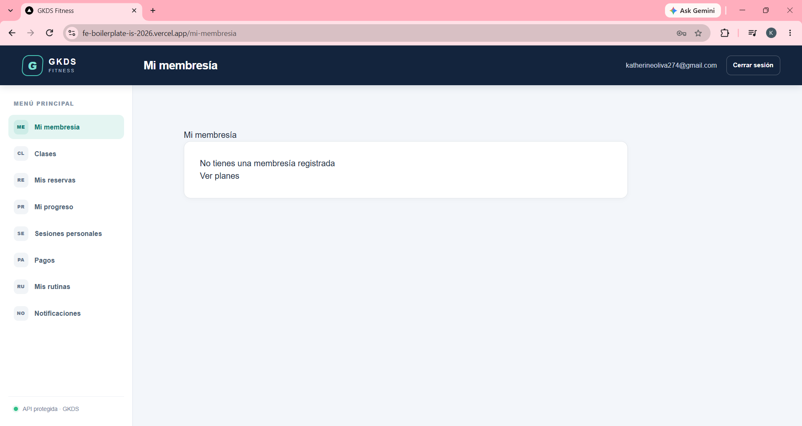

### 4.2 Registrar compra o renovación (H2)

**Rol:** RECEPCION_ADMIN.

1. Inicia sesión con una cuenta de administrador.
2. Entra a la sección "Administración de membresías".
3. Busca al miembro por su número de identificación.
4. Elige uno de los planes disponibles.
5. Indica si es COMPRA o RENOVACIÓN.
6. Revisa el precio, la duración, los beneficios y la fecha de vencimiento prevista.
7. Confirma la solicitud.
8. El sistema registra la solicitud y genera un cobro pendiente.

La membresía solo se activa o se renueva cuando el pago queda confirmado.

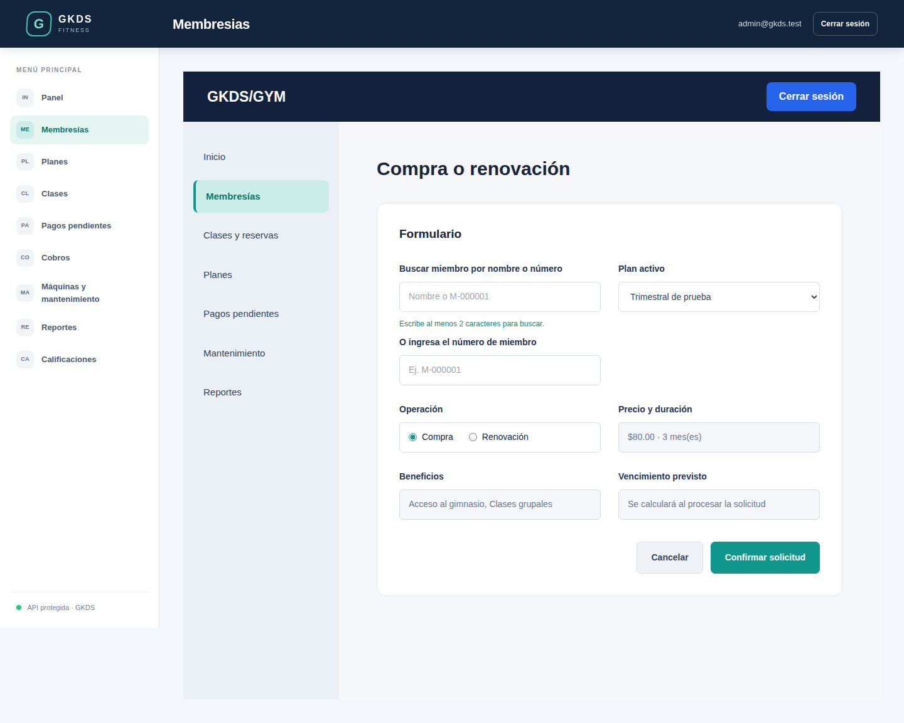

### 4.3 Administrar planes (H3)

**Rol:** RECEPCION_ADMIN.

1. Entra a la sección "Administración de planes".
2. Revisa la lista de planes que ya existen.
3. Presiona "Agregar" para crear un plan nuevo.
4. Llena el nombre, la modalidad, el precio, la duración y los beneficios.
5. Guarda los cambios habiendo completado los campos solicitados.
6. Para modificar un plan o deshabilitarlo, usa las acciones que aparecen junto a cada uno.

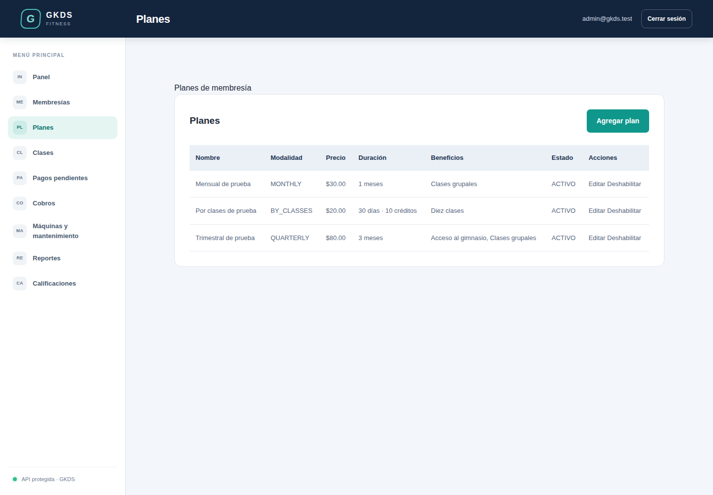

## 5. Módulo 2: Clases grupales

### Consultar y reservar clases (H4–H6)

**Rol:** MIEMBRO.

1. Entra a la sección "Clases".
2. Revisa las sesiones disponibles de la semana.
3. Si se desea, es posible filtrar por clase, entrenador o sala.
4. Elige una sesión que todavía tenga cupos.
5. Confirma la reserva.
6. En "Mis reservas" se podra ver el estado de cada reserva y cancelarla cuando el sistema lo permita.

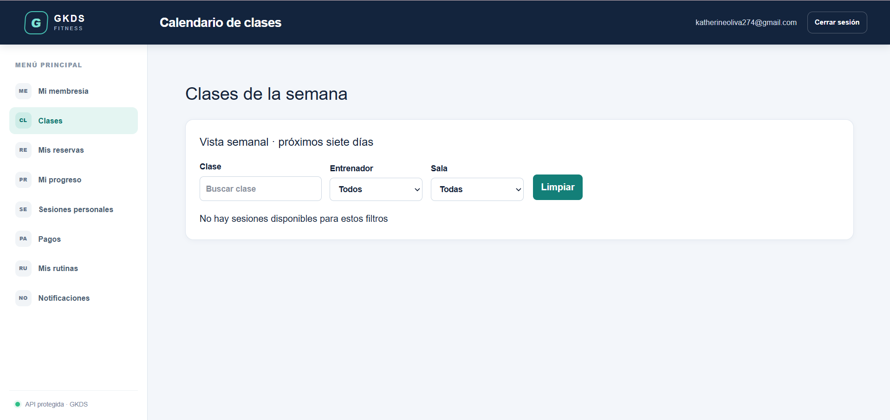

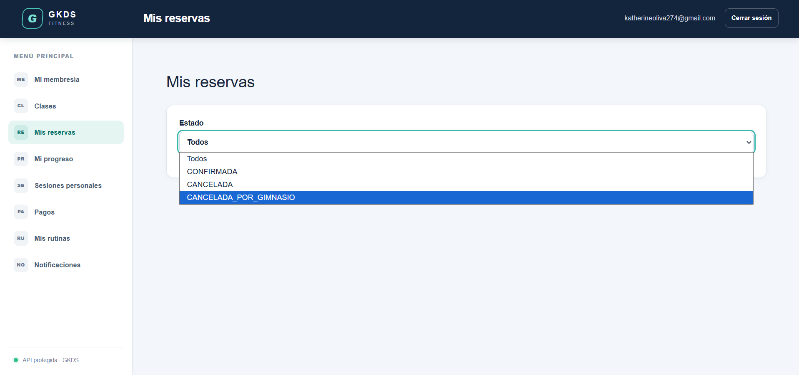

## 6. Módulo 3: Sesiones personales

### Reservar una sesión con entrenador (H10)

**Rol:** MIEMBRO.

1. Entra a la sección "Entrenadores".
2. Elige un entrenador.
3. Revisa los horarios que tiene disponibles.
4. Escoge el horario que se desea.
5. Confirma la solicitud.
6. La sesión seleccionada aparecerá en "Mis sesiones".

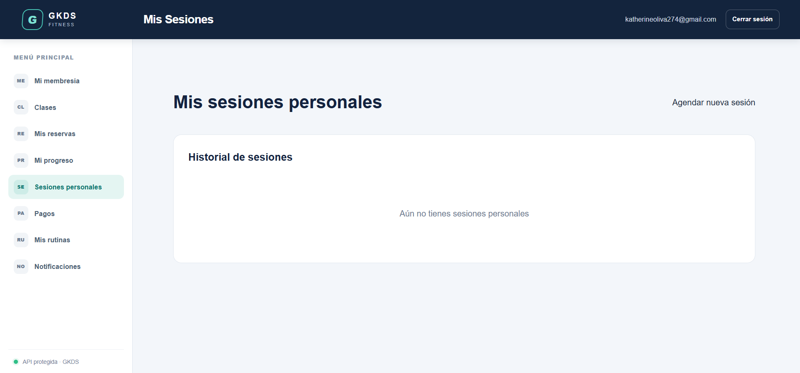

## 7. Módulo 4: Control de ingresos

### Registrar ingreso de un miembro (H13–H14)

**Rol:** RECEPCION_ADMIN.

1. Entra a la sección de recepción.
2. Busca al miembro por su nombre o su número.
3. Revisa el estado de su membresía.
4. Presiona "Registrar ingreso".
5. Si la membresía no está vigente, verificar la advertencia y confirma el ingreso solo si corresponde.
6. Comprueba que el sistema muestre el mensaje de confirmación.

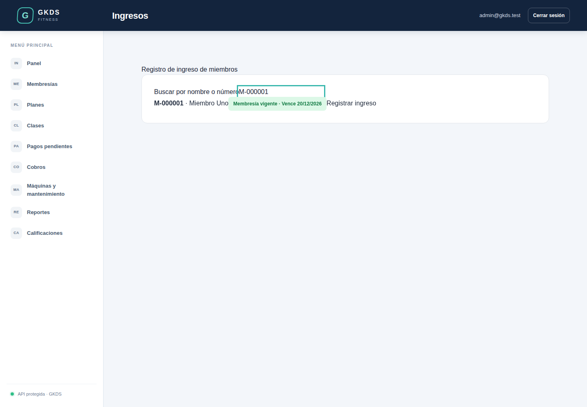

## 8. Módulo 5: Pagos

### Consultar historial de pagos (H18)

**Rol:** MIEMBRO.

1. Entra a la sección "Historial de pagos".
2. Revisa los pagos que se tienen registrados.
3. Si es necesario, es posible filtrar por rango de fechas.
4. Validar la fecha, el concepto, el monto y el estado de cada pago.
5. Descarga el comprobante en PDF cuando esté disponible.

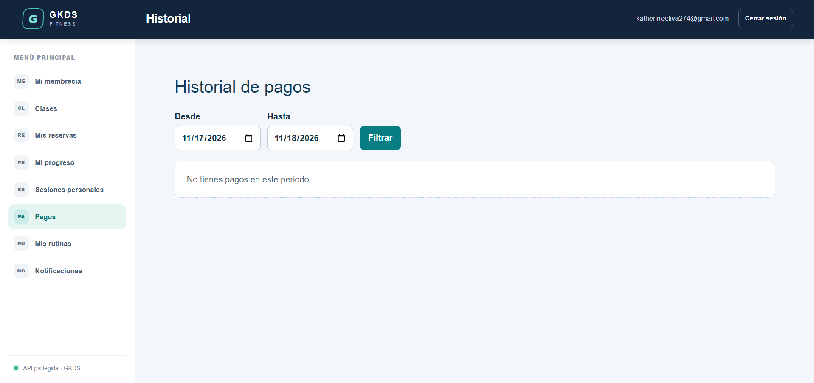

### Consultar pagos pendientes (H20)

**Rol:** RECEPCION_ADMIN.

1. Entra a "Pagos pendientes".
2. Revisa los cobros que siguen pendientes.
3. Consulta los datos del miembro, el concepto, el monto y la fecha de vencimiento.
4. Usa los filtros si se necesita acotar la lista.
5. Identifica cada pago según sus días de atraso.

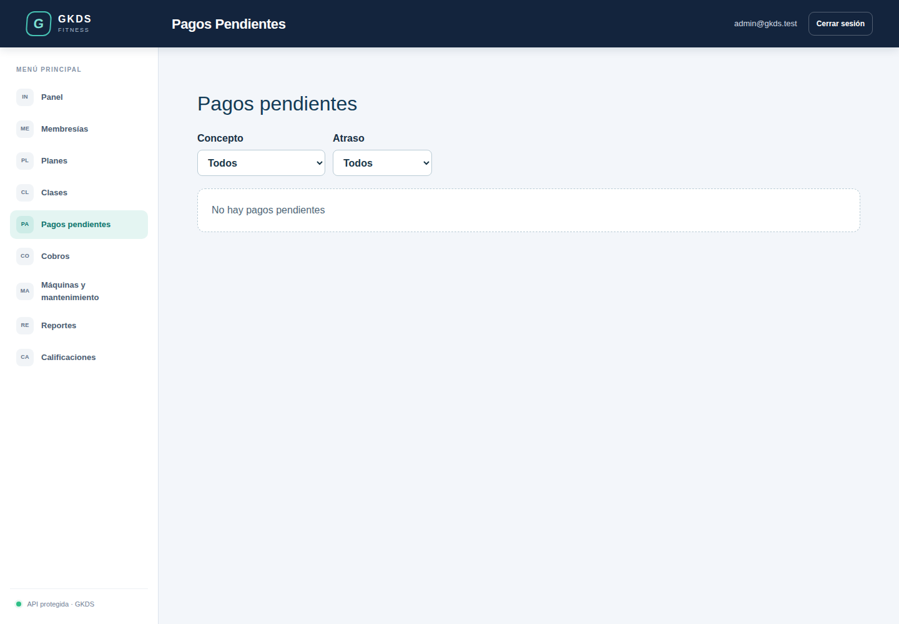

## 9. Módulo 6: Rutinas y progreso

**Roles:** MIEMBRO y ENTRENADOR, según lo que se quiera hacer.

El entrenador puede manejar las rutinas de los miembros que tiene asignados. El miembro puede ver su rutina y registrar su progreso físico.

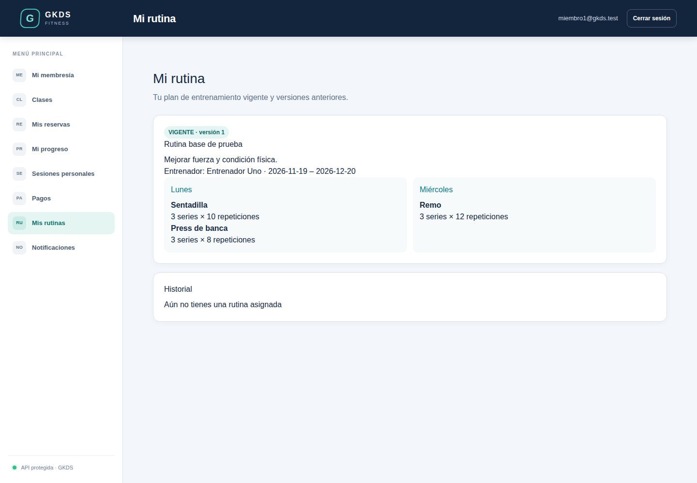

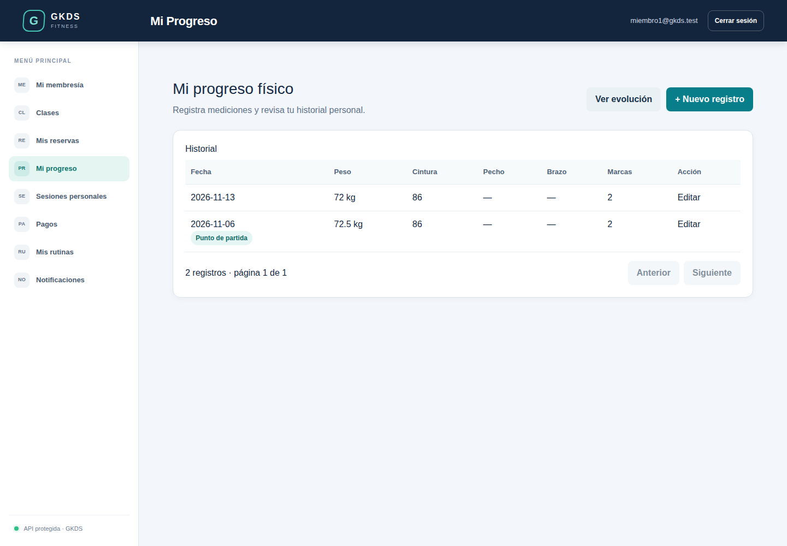

## 10. Módulo 7: Máquinas

**Rol:** RECEPCION_ADMIN para el mantenimiento y la administración. Los demás accesos dependen de lo que permita cada funcionalidad.

1. Entra a la sección "Máquinas".
2. Revisa el catálogo y el estado de cada máquina.
3. Consulta si están disponibles.
4. Si el rol lo permite, administra también los mantenimientos.

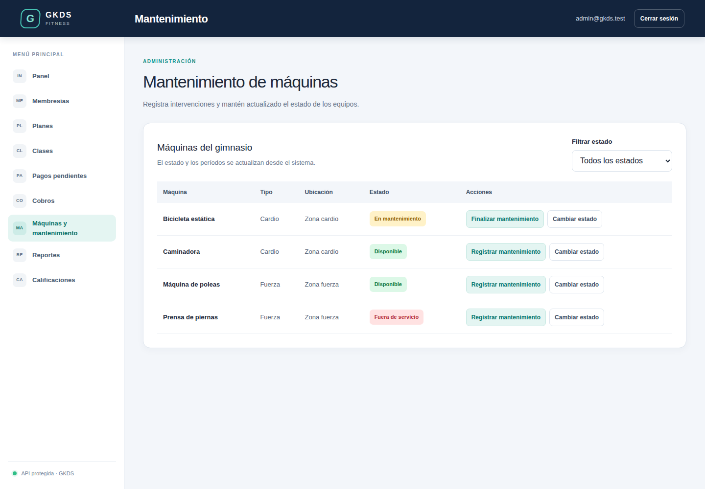

## 11. Módulo 9: Notificaciones

### Consultar notificaciones

1. Inicia sesión.
2. Entra a la sección "Notificaciones".
3. Verificar los mensajes relacionados con las actividades en el gimnasio.
4. Validar el estado de cada notificación.
5. Marcarlas como leídas cuando la opción esté disponible.

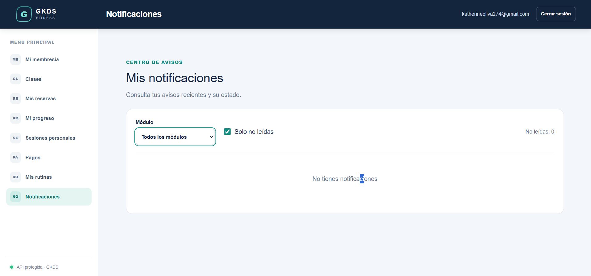
