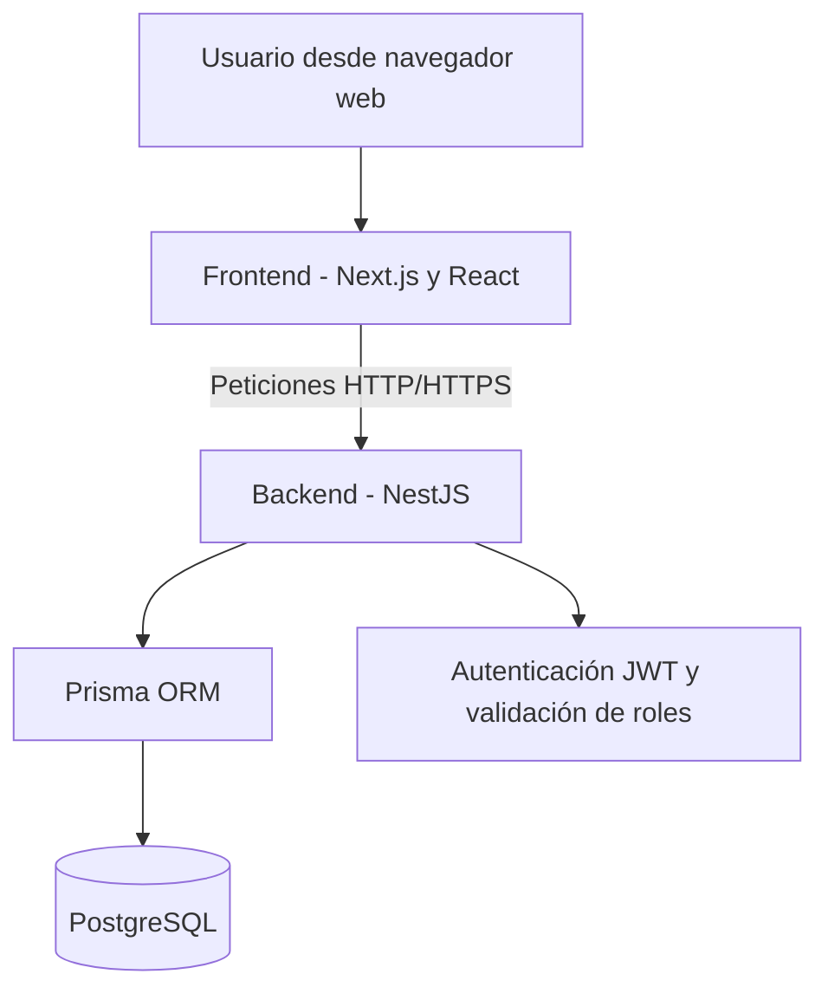
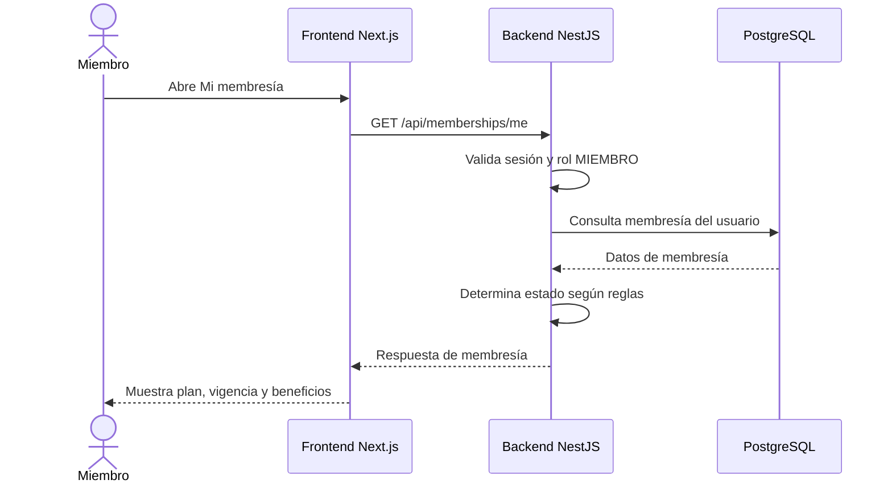
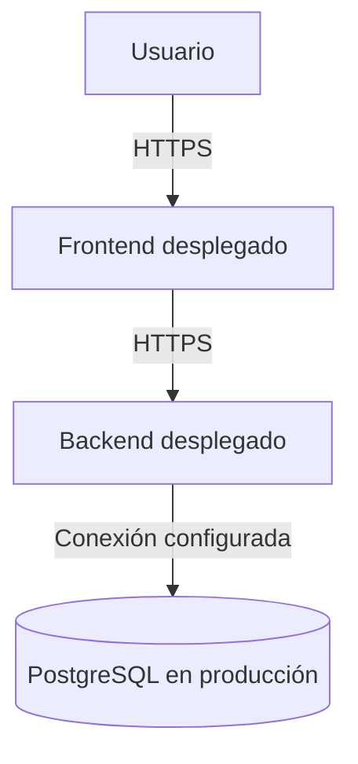

# Arquitectura del sistema

## 1. Descripción general

El Sistema de Gestión de Gimnasio GKDS está dividido en componentes separados: la interfaz de usuario, la lógica de negocio y el almacenamiento de datos.

Con esta división podemos desarrollar, integrar y mantener cada funcionalidad sin que todo dependa de todo.

El sistema tiene tres componentes principales:

- **Frontend:** la interfaz web que usan los miembros, los entrenadores y el personal de recepción y administración.
- **Backend:** recibe las solicitudes y se encarga de las validaciones, la autenticación, la autorización y las reglas de negocio.
- **Base de datos:** guarda de forma permanente los usuarios, membresías, reservas, pagos y el resto de la información del gimnasio.

## 2. Diagrama de arquitectura



El frontend solicita información mediante la API del backend. El backend ejecuta las reglas de negocio, valida permisos y utiliza Prisma para consultar o modificar los datos almacenados en PostgreSQL.

## 3. Tecnologías utilizadas

| Componente | Tecnología | Función |
|---|---|---|
| Frontend | Next.js | Aplicación web |
| Interfaz | React | Componentes y vistas |
| Lenguaje | TypeScript | Tipado y orden en el código |
| Estilos | Tailwind CSS | Diseño de la interfaz |
| Backend | NestJS | API del sistema |
| Base de datos | PostgreSQL | Almacenamiento de la información |
| ORM | Prisma | Acceso a los datos y manejo de modelos |
| Autenticación | JWT y sesión del proyecto base | Identificar a los usuarios |
| Control de versiones | Git y GitHub | Manejo del código |
| Gestión de tareas | Jira | Seguimiento de las historias de usuario |
| Documentación de API | Swagger | Consultar endpoints y contratos |

## 4. Arquitectura del frontend

El frontend usa el App Router de Next.js para manejar las rutas.

La carpeta principal es `app/`, donde están las páginas y los módulos de la aplicación.

### Estructura general

```text
fe_boilerplate_is_2026/
├── app/
│   ├── actions/
│   ├── admin/
│   ├── clases/
│   ├── comprobantes/
│   ├── entrenador/
│   ├── entrenadores/
│   ├── login/
│   ├── maquinas/
│   ├── mi-membresia/
│   ├── mi-progreso/
│   ├── mi-rutina/
│   ├── miembro/
│   ├── mis-reservas/
│   ├── mis-sesiones/
│   ├── notificaciones/
│   ├── pagos/
│   ├── recepcion/
│   ├── globals.css
│   ├── layout.tsx
│   └── page.tsx
├── lib/
├── public/
├── docs/
├── .env.example
├── package.json
└── README.md
```

### Organización de las carpetas

**app/**

Contiene las rutas de la aplicación, organizadas por funcionalidad del gimnasio.

**lib/**

Utilidades y código compartido, como el cliente que usamos para llamar a la API.

**public/**

Archivos públicos que usa la aplicación.

**docs/**

Documentación técnica y funcional del proyecto.

**app/layout.tsx**

Define el diseño raíz de la aplicación.

**app/globals.css**

Estilos globales.

**app/page.tsx**

Página principal de la aplicación.

## 5. Arquitectura del backend

El backend está hecho con NestJS y TypeScript, y ahí viven los servicios del sistema.

Sus tareas principales son:

- Recibir las solicitudes que manda el frontend.
- Autenticar a los usuarios.
- Validar los permisos de cada rol.
- Aplicar las reglas de negocio.
- Administrar membresías, reservas, pagos y el resto de operaciones.
- Consultar y modificar los datos mediante Prisma.
- Exponer los endpoints de la API.
- Ofrecer la documentación con Swagger.


## 6. Base de datos

El sistema usa PostgreSQL con Prisma como ORM.

Los datos se organizan en modelos relacionados entre sí. Algunos de ellos son:

- User y perfiles de usuario.
- MembershipPlan y Membership.
- ClassSession y ClassReservation.
- TrainerSlot y PersonalSession.
- Payment y Receipt.
- Machine y MachineMaintenance.
- TrainingRoutine y ProgressRecord.
- Notification.
- CheckIn.


## 7. Autenticación y autorización

El sistema tiene tres roles:

| Rol | Permisos generales |
|---|---|
| MIEMBRO | Su información personal, reservas, pagos y progreso |
| ENTRENADOR | Su disponibilidad, sus sesiones y las actividades que le asignan |
| RECEPCION_ADMIN | La gestión administrativa y el control del día a día del gimnasio |

Las respuestas de autorización son:

- **401:** el usuario no está autenticado.
- **403:** el usuario está autenticado pero no tiene el permiso necesario.
- **404:** el recurso no existe o el usuario no puede acceder a él, según la operación.

## 8. Comunicación entre componentes

Así es el flujo general de una operación:

1. El usuario hace una acción en la interfaz.
2. El frontend prepara la solicitud.
3. La solicitud llega al backend.
4. El backend revisa la autenticación y los permisos.
5. El backend aplica las reglas de negocio.
6. Prisma hace las consultas o cambios necesarios en PostgreSQL.
7. El backend devuelve la respuesta.
8. El frontend actualiza la pantalla o muestra un mensaje.

### Ejemplo: consulta de membresía



## 9. Decisiones técnicas

| Decisión | Justificación |
|---|---|
| Separación frontend y backend | Nos permite desarrollar e integrar cada parte por separado |
| Next.js App Router | Organiza las pantallas por rutas y módulos |
| TypeScript | Ayuda a definir tipos y contratos |
| NestJS | Ordena la lógica del servidor en módulos y servicios |
| Prisma | Da acceso tipado a PostgreSQL |
| JWT y control de roles | Identifica a los usuarios y protege las operaciones |
| Git Flow | Facilita la integración y el seguimiento de las historias |
| Documentación en Markdown | Mantiene la documentación junto al código |

## 10. Arquitectura de despliegue

La arquitectura de producción queda así:


