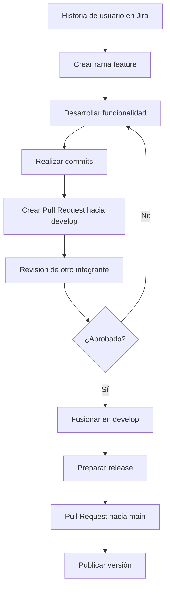

# Forma de trabajo

## 1. Organización del proyecto

El desarrollo del Sistema de Gestión de Gimnasio GKDS se organiza mediante historias de usuario y un flujo de trabajo colaborativo utilizando Git, GitHub y Jira.

Cada integrante tiene asignadas historias de usuario que deben desarrollarse, revisarse e integrarse al proyecto.

El equipo utiliza dos repositorios independientes:

- **Frontend:** [fe_boilerplate_is_2026](https://github.com/katherineoliva274/fe_boilerplate_is_2026)
- **Backend:** [be_boilerplate_is_2026](https://github.com/Michelljk/be_boilerplate_is_2026)

## 2. Tablero de trabajo

**Herramienta:** Jira

**Proyecto:** GKDS

**Tablero:** [Tablero Jira GKDS](https://katherineoliva274.atlassian.net/jira/software/projects/GKDS/boards/3/backlog)

El tablero se utiliza para organizar y dar seguimiento a las historias de usuario del proyecto.


## 3. Ramas (Git Flow)

El equipo utiliza Git Flow para organizar el desarrollo, la integración y la publicación del sistema.

| Rama | Propósito |
|---|---|
| `main` | Contiene la versión publicada del sistema. |
| `develop` | Rama de integración de funcionalidades. |
| `feature/<ID>-<descripcion>` | Desarrollo de una historia de usuario. |
| `release/<version>` | Preparación de una versión para su publicación. |

### Flujo de integración



## 4. Convención de commits

Se utiliza el formato:

`<tipo>(<ID>): <descripción>`

El identificador corresponde a la historia de usuario relacionada con el cambio.

### Tipos de commits

| Tipo | Descripción |
|---|---|
| `feat` | Implementación de una funcionalidad |
| `fix` | Corrección de errores |
| `docs` | Actualización de documentación |
| `test` | Incorporación o modificación de pruebas |
| `refactor` | Reorganización del código sin modificar su comportamiento esperado |
| `chore` | Configuración, mantenimiento y tareas auxiliares |

### Ejemplos

```text
feat(H1): implementa consulta de membresia
feat(H2): agrega formulario de renovacion
fix(H18): corrige filtro del historial de pagos
test(H3): agrega pruebas de administracion de planes
docs: actualiza documentacion tecnica
chore: prepara version 1.0.0
```

## 5. Pull Requests

Los cambios desarrollados en las ramas de funcionalidad se integran mediante Pull Requests en GitHub.

### Procedimiento

1. Crear una rama a partir de la rama de integración correspondiente.
2. Implementar la historia de usuario asignada.
3. Realizar commits identificando la historia.
4. Subir la rama al repositorio remoto.
5. Crear un Pull Request hacia `develop`.
6. Incluir una descripción de los cambios y el enlace a la historia de Jira.
7. Solicitar la revisión de otro integrante del equipo.
8. Corregir las observaciones, cuando corresponda.
9. Obtener la aprobación de otro integrante.
10. Fusionar el Pull Request.
11. Actualizar la historia de Jira con el enlace al PR y su estado real.

### Convención del título

Se recomienda utilizar el identificador de historia:

```text
H18 - Historial de pagos
H20 - Consulta de pagos pendientes
H27 - Administración de máquinas
```

### Descripción del Pull Request

Cada solicitud debe contener:

- Identificador y nombre de la historia.
- Descripción de la funcionalidad.
- Cambios principales realizados.
- Pruebas ejecutadas.
- Enlace a la tarjeta de Jira.
- Observaciones o dependencias, cuando existan.

La aprobación debe realizarla un integrante distinto de quien desarrolló la historia.

## 6. Integración frontend y backend

El proyecto se encuentra dividido en dos repositorios, lo que permite trabajar sobre cada componente de forma independiente.

El frontend está desarrollado con Next.js, React y TypeScript.

El backend está desarrollado con NestJS y Prisma, utilizando PostgreSQL.

Para integrar ambos componentes se requiere:

1. Verificar que los endpoints estén disponibles.
2. Configurar la dirección de la API.
3. Comprobar la autenticación y los permisos.
4. Validar los contratos de solicitud y respuesta.
5. Ejecutar las funcionalidades principales desde la interfaz.
6. Corregir problemas de comunicación o integración.
7. Preparar la versión destinada a publicación.

## 7. Publicación de la versión 1.0.0

El procedimiento establecido para la entrega final es:

1. Integrar las historias terminadas en `develop`.
2. Crear la rama `release/1.0.0` desde `develop`.
3. Realizar únicamente los ajustes finales necesarios.
4. Crear un Pull Request desde `release/1.0.0` hacia `main`.
5. Obtener la aprobación de otro integrante.
6. Fusionar los cambios a `main`.
7. Integrar también la rama de release en `develop`.
8. Crear la etiqueta `v1.0.0` y la correspondiente Release en GitHub.
9. Desplegar el código de `main`.
10. Verificar el funcionamiento de la versión publicada.


## 8. Seguimiento de historias

Cada historia de usuario debe registrar:

- Identificador de la historia.
- Nombre y módulo.
- Integrante responsable.
- Enlace a la tarjeta de Jira.
- Enlace al Pull Request.
- Estado real de implementación.
- Observaciones o motivos de pendientes.
